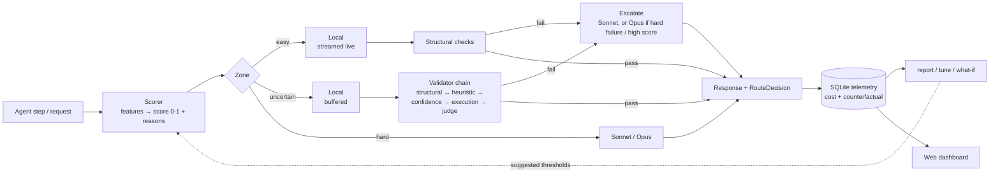

# hybrid-router

Run as much of an agent's LLM work as possible on a local model (Ollama on your Mac), and escalate to Claude (Sonnet, then Opus, through [OpenRouter](https://openrouter.ai)) only when needed. Every call is recorded with its routing decision, its actual cost, and what it would have cost if every call had gone to the cloud. That shows you the local vs cloud split and how much you saved.

It comes as a Python SDK, a command-line tool (`hybrid-router`), and a web app (chat, agent runs, side-by-side compare, tuning, dashboard).

---

## Setup and first run (macOS)

**Time needed:** about 15 minutes, most of it downloading the local model.

### 1. What you need

| | Version | Why | Check with |
|---|---|---|---|
| Mac with Apple Silicon (M1 or later) | 16 GB RAM or more | The local model needs about 6 GB of memory while it runs | — |
| [Homebrew](https://brew.sh) | any | Installs everything else | `brew --version` |
| git | any | Gets the code | `git --version` |
| [uv](https://docs.astral.sh/uv/) | 0.5 or newer | Installs Python 3.12 and all Python packages for you. **You don't need to install Python yourself.** | `uv --version` |
| Node.js | 20.19+ or 22.12+ | Only used to build the web UI | `node --version` |
| pnpm | 10 | Node package manager. The setup script enables it for you. | `pnpm --version` |
| [Ollama](https://ollama.com) | latest | Runs the local model | `ollama --version` |
| [OpenRouter](https://openrouter.ai) account | — | Reaches Claude in the cloud. You need an API key and a few dollars of credit. | — |

You can try the whole app without Ollama or OpenRouter: step 4 runs it with demo models. You only need them for real answers.

### 2. Install the tools

If you don't have Homebrew yet, install it first by following the one-line instructions at <https://brew.sh>.

Then, in Terminal:

```bash
brew install git uv node ollama
```

Open a **new terminal window** afterwards so the new commands are on your `PATH`. Then check that the versions meet the table above:

```bash
uv --version && node --version && ollama --version
```

### 3. Get the code and run setup

```bash
git clone https://github.com/devangaggarwal4/orchestration-sdk.git
cd orchestration-sdk
git checkout claude/hybrid-router-sdk-plan-v04kuo   # the code lives on this branch until it's merged
./scripts/setup.sh
```

`setup.sh` does four things:
1. Checks the versions above and tells you exactly what to install if something is missing.
2. Downloads Python 3.12 into the project if you don't have it. Python is pinned in `.python-version`.
3. Installs the Python packages into `.venv/`.
4. Installs and builds the web UI.

It's safe to re-run at any time. It should finish with:

```
Done. Next:
  uv run hybrid-router web --fake-backends     # try the app with demo models (no Ollama/key needed)
  ...
```

> **Run every command from the `orchestration-sdk` folder.**
> - The `uv run` prefix uses the project's own Python environment. You never need to activate a virtualenv.
> - Your config (`hybrid_router.yaml`) and data (`hybrid_router.sqlite`) are read from and written to that folder.

### 4. Try it with demo models (optional, no Ollama or key needed)

```bash
uv run hybrid-router web --fake-backends
```

Open <http://127.0.0.1:8765>.
- **Chat:** send something easy ("hi") and something hard ("design a distributed lock and its trade-offs"). Then click **Why?** under each reply to see how it was routed.
- **Stop the server:** press `Ctrl+C` in the terminal.

Demo data goes to a separate `hybrid_router.demo.sqlite`, so it never mixes with your real data.

### 5. Set up the local model

Start Ollama and keep it running in the background, including after a reboot:

```bash
brew services start ollama
```

Alternatively, run `ollama serve` in a terminal you leave open.

Then download the default model (about 5 GB):

```bash
ollama pull qwen3:8b
ollama list            # qwen3:8b should be listed
```

### 6. Add your OpenRouter key

1. Create a key at <https://openrouter.ai/keys>, and add credit at <https://openrouter.ai/credits>. A few dollars is plenty to start.
2. Save it in your shell profile so every new terminal has it:

```bash
echo 'export OPENROUTER_API_KEY="sk-or-...your key..."' >> ~/.zshrc
source ~/.zshrc
```

### 7. Check that everything is connected

```bash
uv run hybrid-router smoke
```

`smoke` runs three checks on each tier (local, sonnet, opus):
- Is it reachable, and does the model exist?
- Does a streamed one-word reply come back?
- Does a tool call work?

It also prints latency, tokens and the cost OpenRouter reported. The cloud checks cost a fraction of a cent.

- **When everything is set up,** all three rows show ✓.
- **If something is wrong,** the lines under the table say exactly what, for example `✗ local: ollama unreachable at http://localhost:11434`. See [Troubleshooting](#troubleshooting).

Use `uv run hybrid-router smoke --skip-cloud` to check only the local model.

### 8. Run it

```bash
uv run hybrid-router web
```

Open <http://127.0.0.1:8765>. The pages are:
- **Chat:** talk through the router.
- **Agent runs:** give the example agent a task.
- **Compare:** run strategies side by side.
- **Tuning:** adjust thresholds with a live what-if.
- **Dashboard:** savings and the local vs cloud split.

Everything you do is recorded in `hybrid_router.sqlite`.

### 9. Optional: your own settings

The defaults work without a config file. To change models, thresholds or budgets:

```bash
cp hybrid_router.example.yaml hybrid_router.yaml    # every option is documented in this file
uv run hybrid-router config                         # shows the settings actually in effect
```

The Tuning page also edits this file for you. It always shows you a diff first and keeps a backup.

---

## Troubleshooting

| You see | Fix |
|---|---|
| `command not found: uv` (or `node`, `ollama`) right after installing | Open a new terminal window. If it persists, run `brew install <name>` again and read its output. |
| `Node 18.x is too old` from `setup.sh` | Run `brew upgrade node` and open a new terminal. |
| `pnpm: command not found` | `corepack enable pnpm`. Or: `npm install -g pnpm@10` |
| `✗ local: ollama unreachable at http://localhost:11434` | Ollama isn't running: `brew services start ollama` (or `ollama serve` in another terminal). |
| `ollama ... is up but 'qwen3:8b' is not pulled` | `ollama pull qwen3:8b` |
| `✗ sonnet: no API key: set OPENROUTER_API_KEY` | Do step 6, then open a new terminal (or `source ~/.zshrc`). Check it with `echo $OPENROUTER_API_KEY`. |
| `401 ... (check OPENROUTER_API_KEY)` | The key is wrong or revoked. Create a new one at openrouter.ai/keys. |
| `402 ... (out of OpenRouter credits?)` | Add credit at openrouter.ai/credits. |
| `model 'anthropic/...' not offered at https://openrouter.ai/api/v1` | The model id has changed on OpenRouter. Copy the current id from <https://openrouter.ai/models> into `tiers.sonnet.model` / `tiers.opus.model` in `hybrid_router.yaml`. |
| The browser shows "The web UI isn't built" | `./scripts/setup.sh` (or `cd frontend && pnpm install && pnpm build`) |
| `address already in use` | Another copy is running. Stop it with `Ctrl+C`, or use another port: `uv run hybrid-router web --port 8800` |
| `refusing to listen on 0.0.0.0 without a token` | See [Reaching it from your phone](#reaching-it-from-your-phone-or-tailnet). |
| `logprobs requested but none returned` in `smoke` | Your Ollama is too old for logprobs: `brew upgrade ollama`. Everything still works without them; only the confidence check is skipped. |
| Local replies are very slow | Close memory-heavy apps, or use a smaller model: `ollama pull qwen3:4b`, then set `HYBRID_ROUTER__TIERS__LOCAL__MODEL=qwen3:4b`. |
| `uv run` tries to download Python and fails | Install it once explicitly with `uv python install 3.12`, then re-run `./scripts/setup.sh`. |

---

## Everyday commands

| Command | What it does |
|---|---|
| `uv run hybrid-router web` | Start the web app at http://127.0.0.1:8765 |
| `uv run hybrid-router smoke` | Check that the local model and Claude are reachable |
| `uv run hybrid-router report --since 7d` | Local vs cloud split, cost vs all-cloud, escalations, latency |
| `uv run hybrid-router tune --since 30d` | Suggest better thresholds from your own traffic (changes nothing) |
| `uv run hybrid-router whatif --set routing.hard_threshold=0.5` | Replay past traffic under a changed setting (no model calls) |
| `uv run hybrid-router eval --simulate` | Compare routing strategies offline; drop `--simulate` to use real models (spends up to `--budget-usd`, default $2) |
| `uv run hybrid-router config` | Show the settings in effect |
| `uv run hybrid-router --help` | List every command; add `--help` after any command for its options |

**Updating to new code:**

```bash
git pull
./scripts/setup.sh
```

---

## How it works



1. **Score.** The scorer turns cheap features of the request into a difficulty score between 0 and 1. The features are context size, number of tools, `task_type`, hard keywords in the latest message, and response-schema complexity. Two boosts are added on top: one for the steps right after an escalation in the same session, and one when the previous local step's tool call errored. Every score carries human-readable reasons. No model is called to judge difficulty.
2. **Route by zone.** Each request lands in one of three zones:
   - **Easy:** goes local and streams immediately, with only structural checks.
   - **Hard:** skips local and goes to Sonnet, or to Opus above `opus_threshold`.
   - **Uncertain:** runs locally, but the output is held back until the full validator chain passes.
3. **Escalate on failure.** If a local answer fails validation, it is discarded and the request escalates:
   - **To Opus** when the failure is "hard" (broken JSON, an unknown tool, code that doesn't compile) or the score was above `opus_threshold`.
   - **To Sonnet** otherwise.

   By default the original request is re-sent. With `escalation_mode: revise`, the failed draft is sent too, as "revise this" context.
4. **Record.** Telemetry stores one row per model call and one per routed request: score, zone, reasons, validator results, tokens, latency, actual cost, the all-cloud counterfactual, and "cascade waste" (time and tokens spent on local attempts that were thrown away).

The default strategy, **hybrid**, does all of the above. Two other strategies exist for comparison:
- **pre_route:** the tier is chosen from the score alone, with no validation-based escalation.
- **cascade:** every request starts local, and escalates whenever validation fails.

## Use it from Python

Run your script with `uv run python your_script.py` from the project folder, so it uses the project's environment.

```python
import asyncio
from hybrid_router import HybridRouter

async def main():
    router = HybridRouter.from_config()          # reads hybrid_router.yaml if present
    result = await router.acomplete(
        "Extract the invoice total from: 'Amount due: 1,240.50 EUR'",
        task_type="extract",
        session_id="run-42",                     # stickiness is per session
    )
    print(result.text)
    d = result.decision
    print(d.final_tier, d.score, d.zone, d.reasons, d.escalated)
    await router.aclose()

asyncio.run(main())
```

**Other entry points**
- **Streaming:** `router.astream(...)` yields events. You get the route start, the attempts, text deltas, and a final `RouteEndEvent`.
- **Sync code:** `router.complete(...)` is a blocking wrapper.
- **Override routing:** `force_tier="local" | "sonnet" | "opus"` skips the routing decision, and `strategy=` picks the strategy per call.

**Agents**
- `hybrid_router.agent.Agent` is a small tool-using agent that routes every step under one session. `uv run python examples/agent/run_agent.py "your question"` shows it; add `--simulate` to run it with no models.
- **LangGraph / LangChain:** `hybrid_router.adapters.langgraph.HybridRouterChatModel(router=router).bind_tools(tools)`. Needs `uv sync --extra web --extra langgraph`.
- **Claude Agent SDK:** `hybrid_router.adapters.claude_agent_sdk.delegate_local_server(router)` adds a `delegate_local` tool, so Claude can hand simple subtasks to the router. Needs `--extra agent-sdk`.

## The web app

| Page | What you can do |
|---|---|
| **Chat** | Chat through the router. Every reply has a card showing which tier answered, the score and its reasons, the zone, the attempts, validator results, any discarded drafts, and the cost. You can set strategy, task type, force a tier, and turn on workspace tools. |
| **Agent runs** | Give the example agent a task and watch each step get routed live, with tool calls, escalations and running cost. Runs can be cancelled and replayed. |
| **Compare** | Send one prompt, or one eval task with a checked answer, under hybrid, pre-route, cascade, all-local and all-cloud side by side. You can also launch full eval runs from here. |
| **Tuning** | Drag thresholds and weights and see a what-if replay of past traffic instead of guessing. Apply `tune` suggestions, review the YAML diff, then apply. The file is backed up and the router reloads live. |
| **Dashboard** | Savings vs all-cloud, local share, escalation rate, budget, and the `report` views as charts, each with a table view. |

### Reaching it from your phone or tailnet

```bash
export HYBRID_ROUTER_WEB_TOKEN=$(openssl rand -hex 24)
echo $HYBRID_ROUTER_WEB_TOKEN        # you'll paste this into the browser once
uv run hybrid-router web --host 0.0.0.0
```

Then open `http://<your-mac's-name-or-IP>:8765` from the other device and enter the token. For HTTPS, put it behind `tailscale serve`.

**Security notes**
- The agent's `run_python` tool is off unless `agent.allow_code_exec: true`. With it on, anyone who can reach the app can run code on your Mac.
- `routing.daily_cloud_budget_usd` caps cloud spend per day. Once it's reached, requests stay local and their reasons say so.

## Tuning the thresholds

1. **Collect data.** Route real traffic for a few days, or run `uv run hybrid-router eval`. `tune` needs at least 50 requests that tried the local model first. A week on `strategy: cascade` gives the best data, because every score gets a local attempt.
2. **Read the failure-rate table** from `uv run hybrid-router tune`. It shows, for each score bin, how often local failed.
   - **Lower `hard_threshold`** where bins keep failing (≥ 70%). The tool says, for example, "scores 0.45-0.65 escalated 95% of the time". Sending those straight to the cloud saves the wasted local attempt.
   - **Raise `easy_threshold`** where local almost always succeeds (≥ 90%). More requests then stream immediately with only light checks.
3. **Check the price of a change with `whatif`**, or with the Tuning page's sliders. It replays recorded requests under the new settings without calling any model, and reports three numbers:
   - the change in latency and cost;
   - the expected new "under-escalations": requests that would now be answered locally and wrongly.

   Effects are marked *observed* when the request already ran the way the new settings would send it, and *estimated* otherwise.
4. **Weights.** `tune` refits feature weights and only suggests them when they predict local failure better than the current ones, measured by AUC. To go further, `uv run hybrid-router train-scorer` plus `scorer.kind: learned` uses a fitted logistic model instead.
5. **Check quality offline.** Use `uv run hybrid-router eval` to compare quality, cost and routing accuracy across strategies before keeping a change.

## Cost accounting

- **Actual cost** is what OpenRouter reports per call (`usage.cost`). Local calls cost $0, plus an optional per-hour electricity/amortization rate set in `pricing.yaml`.
- **The counterfactual** prices each request as if it had gone to the baseline tier (Sonnet by default):
  - Local requests are priced as local tokens × a local-to-Claude token ratio. The ratio is learned from escalated requests, where both counts are known.
  - The session's observed prompt-cache hit rate is applied to those local requests.
  - Requests that needed Opus show *negative* savings.
- **`pricing.yaml` holds placeholder prices.** Verify each one on [openrouter.ai/models](https://openrouter.ai/models) and set `verified: true`. Until you do, reports label the counterfactual as an estimate.

## Configuration reference

Settings are applied in this order (later wins):
1. Built-in defaults.
2. `hybrid_router.yaml` in the folder you run from, or the file named by `$HYBRID_ROUTER_CONFIG` or `--config`.
3. Environment variables.

| Environment variable | Purpose |
|---|---|
| `OPENROUTER_API_KEY` | Cloud tiers (Claude via OpenRouter). |
| `HYBRID_ROUTER_CONFIG` | Path to the config file. |
| `HYBRID_ROUTER__SECTION__KEY=value` | Override any setting, e.g. `HYBRID_ROUTER__TIERS__LOCAL__MODEL=llama3.1:8b` or `HYBRID_ROUTER__ROUTING__HARD_THRESHOLD=0.5`. |
| `HYBRID_ROUTER_WEB_TOKEN` | Bearer token for the web app; required when it listens on anything but localhost. |

**Other runtimes.** A tier can use `kind: openai_compat` to talk to any OpenAI-compatible server instead of Ollama, such as llama.cpp's `llama-server`, LM Studio, vLLM or `mlx_lm.server`. `hybrid_router.example.yaml` shows how.

## Development

```bash
./scripts/check.sh            # ruff, pyright, pytest, and frontend lint/typecheck/tests
uv run pytest -m integration  # live tests: needs Ollama + OPENROUTER_API_KEY
cd frontend && pnpm dev       # UI dev server with hot reload (proxies /api to a running `hybrid-router web`)
cd frontend && pnpm gen:api   # regenerate API types after backend changes
cd frontend && pnpm build && pnpm e2e   # browser tests against `web --fake-backends`
```

The design and the decisions behind it are in [`docs/PLAN.md`](docs/PLAN.md); the conventions are in [`CLAUDE.md`](CLAUDE.md).
