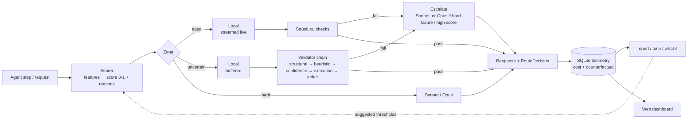

# hybrid-router

Run as much of an agent's LLM work as possible on a local model (Ollama on your Mac), and escalate to Claude (Sonnet, then Opus, through [OpenRouter](https://openrouter.ai)) only when needed. Every call is recorded with its routing decision, its actual cost, and what it would have cost if every call had gone to the cloud. That lets you see the local vs cloud split and the money saved.

It comes as a Python SDK, a CLI, and a web app (chat, agent runs, side-by-side compare, tuning, dashboard).

## How it works



1. **Score.** The scorer turns cheap features of the request into a difficulty score between 0 and 1. The features are context size, number of tools, `task_type`, hard keywords in the latest message, and response-schema complexity. Two boosts are added on top: one for the steps right after an escalation in the same session, and one when the previous local step's tool call errored. Every score carries human-readable reasons. No model is called to judge difficulty.
2. **Route by zone.** Each request lands in one of three zones:
   - **Easy:** goes local and streams immediately, with only structural checks.
   - **Hard:** skips local and goes to Sonnet, or to Opus above `opus_threshold`.
   - **Uncertain:** runs locally, but the output is held back until the full validator chain passes.
3. **Escalate on failure.** If a local answer fails validation, it is discarded and the request escalates:
   - **To Opus** when the failure is "hard" (broken JSON, an unknown tool, code that doesn't compile) or the score was above `opus_threshold`.
   - **To Sonnet** otherwise.

   By default the original request is re-sent. With `escalation_mode: revise`, the failed draft is sent too, as "revise this" context.
4. **Record.** Telemetry stores one row per model call and one per routed request: score, zone, reasons, validator results, tokens, latency, actual cost, the all-cloud counterfactual, and "cascade waste" (time and tokens spent on local attempts that were thrown away).

The default strategy, **hybrid**, does all of the above. Two other strategies exist for comparison:
- **pre_route:** the tier is chosen from the score alone, with no validation-based escalation.
- **cascade:** every request starts local, and escalates whenever validation fails.

## Setup (macOS, 16 GB)

```bash
# 1. Local model
brew install ollama && ollama serve            # or the Ollama app
ollama pull qwen3:8b                           # default local model (~5 GB at Q4)
ollama pull nomic-embed-text                   # only for the experimental EmbeddingScorer

# 2. Python 3.11+ with uv
uv sync --extra web                            # SDK + CLI + web app

# 3. Claude via OpenRouter (https://openrouter.ai/keys)
export OPENROUTER_API_KEY=sk-or-...

# 4. Check every tier
uv run hybrid-router smoke                     # --skip-cloud for local only
```

`smoke` checks each tier:
- Its health. For cloud tiers this also confirms the model id exists on OpenRouter.
- A streamed one-word reply, reporting time to first token, latency, tokens, logprobs, and the cost OpenRouter reported.
- One tool call.

**Environment variables**

| Variable | Purpose |
|---|---|
| `OPENROUTER_API_KEY` | Cloud tiers (Claude via OpenRouter). |
| `HYBRID_ROUTER_CONFIG` | Path to the config file (default `./hybrid_router.yaml`). |
| `HYBRID_ROUTER__SECTION__KEY=value` | Override any setting, e.g. `HYBRID_ROUTER__TIERS__LOCAL__MODEL=llama3.1:8b`. |
| `HYBRID_ROUTER_WEB_TOKEN` | Bearer token for the web app; required when binding to anything but localhost. |

## Use it from Python

```python
import asyncio
from hybrid_router import HybridRouter

async def main():
    router = HybridRouter.from_config()          # reads hybrid_router.yaml if present
    result = await router.acomplete(
        "Extract the invoice total from: 'Amount due: 1,240.50 EUR'",
        task_type="extract",
        session_id="run-42",                     # stickiness is per session
    )
    print(result.text)
    d = result.decision
    print(d.final_tier, d.score, d.zone, d.reasons, d.escalated)
    await router.aclose()

asyncio.run(main())
```

**Other entry points**
- **Streaming:** `router.astream(...)` yields events. You get the route start, the attempts, text deltas, and a final `RouteEndEvent`.
- **Sync code:** `router.complete(...)` is a blocking wrapper.
- **Override routing:** `force_tier="local" | "sonnet" | "opus"` skips the routing decision, and `strategy=` picks the strategy per call.

**Agents**
- `hybrid_router.agent.Agent` is a small tool-using agent that routes every step under one session. `examples/agent/run_agent.py` shows it; add `--simulate` to run it with no models.
- **LangGraph / LangChain:** `hybrid_router.adapters.langgraph.HybridRouterChatModel(router=router).bind_tools(tools)`. Needs `--extra langgraph`.
- **Claude Agent SDK:** `hybrid_router.adapters.claude_agent_sdk.delegate_local_server(router)` adds a `delegate_local` tool, so Claude can hand simple subtasks to the router. Needs `--extra agent-sdk`.

## Web app

```bash
cd frontend && pnpm install && pnpm build && cd ..     # once (or after frontend changes)
uv run hybrid-router web                                # http://127.0.0.1:8765
uv run hybrid-router web --fake-backends                # demo models, no Ollama or key needed
```

| Page | What you can do |
|---|---|
| **Chat** | Chat through the router. Every reply has a card showing which tier answered, the score and its reasons, the zone, the attempts, validator results, any discarded drafts, and the cost. You can set strategy, task type, force a tier, and turn on workspace tools. |
| **Agent runs** | Give the example agent a task and watch each step get routed live, with tool calls, escalations and running cost. Runs can be cancelled and replayed. |
| **Compare** | Send one prompt, or one eval task with a checked answer, under hybrid, pre-route, cascade, all-local and all-cloud side by side. You can also launch full eval runs from here. |
| **Tuning** | Drag thresholds and weights and see a what-if replay of past traffic instead of guessing. Apply `tune` suggestions, review the YAML diff, then apply. The file is backed up and the router reloads live. |
| **Dashboard** | Savings vs all-cloud, local share, escalation rate, budget, and the `report` views as charts, each with a table view. |

**Reaching it from your phone or tailnet**

```bash
export HYBRID_ROUTER_WEB_TOKEN=$(openssl rand -hex 24)
uv run hybrid-router web --host 0.0.0.0
```

The app asks for the token once. For HTTPS, put it behind `tailscale serve`.

**Security notes**
- The agent's `run_python` tool is off unless `agent.allow_code_exec: true`. With it on, anyone who can reach the app can run code on your Mac.
- `routing.daily_cloud_budget_usd` caps cloud spend per day. Once it's reached, requests stay local and their reasons say so.

## Reports and tuning

```bash
uv run hybrid-router report --since 7d     # split, cost vs all-cloud, zones, escalations, waste, latency
uv run hybrid-router tune --since 30d      # suggested thresholds/weights + YAML patch
uv run hybrid-router whatif --set routing.hard_threshold=0.5 --since 30d
uv run hybrid-router eval --simulate       # compare strategies offline (drop --simulate for real models)
uv run hybrid-router train-scorer          # fit the LearnedScorer on your telemetry
```

### How to tune the thresholds

1. **Collect data.** Route real traffic for a few days, or run `hybrid-router eval`. `tune` needs at least 50 requests that tried the local model first. A week on `strategy: cascade` gives the best data, because every score gets a local attempt.
2. **Read the failure-rate table** from `hybrid-router tune`. It shows, for each score bin, how often local failed.
   - **Lower `hard_threshold`** where bins keep failing (≥ 70%). The tool says, for example, "scores 0.45-0.65 escalated 95% of the time". Sending those straight to the cloud saves the wasted local attempt.
   - **Raise `easy_threshold`** where local almost always succeeds (≥ 90%). More requests then stream immediately with only light checks.
3. **Check the price of a change with `whatif`**, or with the Tuning page's sliders. It replays recorded requests under the new settings without calling any model, and reports three numbers:
   - the change in latency and cost;
   - the expected new "under-escalations": requests that would now be answered locally and wrongly.

   Effects are marked *observed* when the request already ran the way the new settings would send it, and *estimated* otherwise.
4. **Weights.** `tune` refits feature weights and only suggests them when they predict local failure better than the current ones, measured by AUC. To go further, `train-scorer` plus `scorer.kind: learned` uses a fitted logistic model instead.
5. **Check quality offline.** Use `hybrid-router eval` to compare quality, cost and routing accuracy across strategies before keeping a change.

## Cost accounting

- **Actual cost** is what OpenRouter reports per call (`usage.cost`). Local calls cost $0, plus an optional per-hour electricity/amortization rate set in `pricing.yaml`.
- **The counterfactual** prices each request as if it had gone to the baseline tier (Sonnet by default):
  - Local requests are priced as local tokens × a local-to-Claude token ratio. The ratio is learned from escalated requests, where both counts are known.
  - The session's observed prompt-cache hit rate is applied to those local requests.
  - Requests that needed Opus show *negative* savings.
- **`pricing.yaml` holds placeholder prices.** Verify each one on [openrouter.ai/models](https://openrouter.ai/models) and set `verified: true`. Until you do, reports label the counterfactual as an estimate.

## Configuration

Copy `hybrid_router.example.yaml` to `hybrid_router.yaml`; every option is documented there. `uv run hybrid-router config` prints the resolved config.

**Other runtimes.** A tier can use `kind: openai_compat` to talk to any OpenAI-compatible server instead of Ollama, such as llama.cpp's `llama-server`, LM Studio, vLLM or `mlx_lm.server`. For anything else, write a `Backend` subclass and register it; the router doesn't change.

## Development

```bash
./scripts/check.sh            # ruff, pyright, pytest, and frontend lint/typecheck/tests
uv run pytest -m integration  # live: needs Ollama + OPENROUTER_API_KEY
cd frontend && pnpm dev       # UI dev server (proxies /api to :8765)
cd frontend && pnpm gen:api   # regenerate API types after backend changes
cd frontend && pnpm build && pnpm e2e   # Playwright against `web --fake-backends`
```

The design and the decisions behind it are in [`docs/PLAN.md`](docs/PLAN.md); the conventions are in [`CLAUDE.md`](CLAUDE.md).
